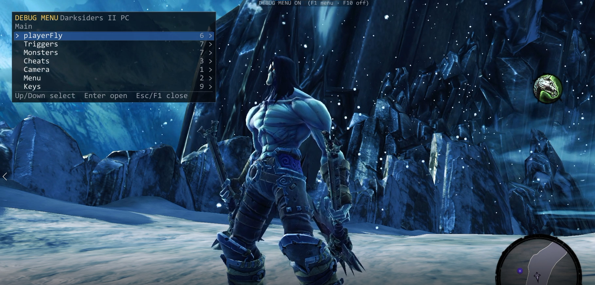
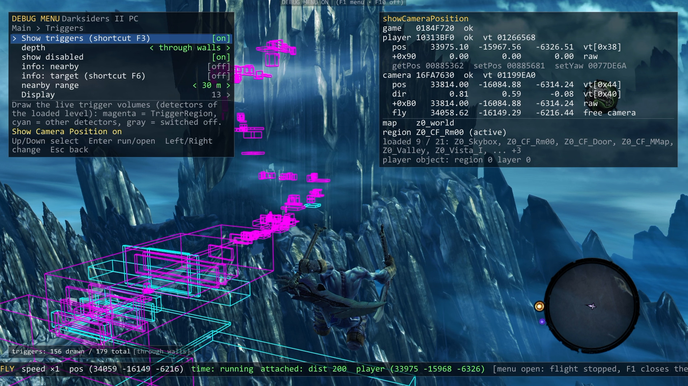

# Darksiders II Debug Menu (PC 2012)

An unofficial mod that brings part of the developers' debug menu from the **Xbox 360 DEBUG build** of Darksiders II
to the **original PC version of Darksiders II (2012)**: free-camera flight with teleport, visible trigger zones,
enemy info and a few cheats.
It does **not** work with Darksiders II Deathinitive Edition.

> [!IMPORTANT]
> **The debug menu is OFF after the game starts. Press F10 to turn it on — only then the other keys work.**
> Then: **F1** — menu, **F2** — free flight, **F3** — show triggers, **F5** — enemy info, **F6** — trigger info.
> Press **F10** again to turn everything off.





## Video

<!-- drop dsoverview.mp4 here -->

## Features

The menu is split into sections, like the Xbox debug menu.

**playerFly**
- Free camera flight while the world keeps living (enemies, water, triggers).
- Teleport the hero to the camera point; the game camera smoothly returns behind the hero.
- After the teleport the hero hangs in the air; Space jumps (and double-jumps), moving or attacking lets go.
- Carry the hero in front of the camera through walls (he touches triggers on the way).
- Freeze / run the game time during the flight.

**Triggers**
- Draw the live trigger zones of the level: magenta — triggers, cyan — other zones, gray — switched off.
- Lines through walls or hidden by walls (depth).
- Labels on the triggers nearby; a panel about the trigger in the centre of the screen (F6).
- "Leads to": for level transitions — the world, region and spawn point; also what a trigger loads or calls.
- Display folder: choose every line of the labels and the panel.

**Monsters**
- Labels over the enemies: name, health, level, attacks, AI, cooldowns, target, hits.
- A panel about the enemy in the centre of the screen (F5).
- Display folder: choose every line of the labels and the panel.
- Damage info — the game's own damage numbers over enemies.
- Freeze monsters — enemies stop moving and attacking.

**Cheats** (no hotkeys)
- Invincible — the hero takes no damage.
- One-hit kill — any hit of the hero kills an enemy (bosses take normal damage during their fight).
- Kill all monsters — kills every enemy on the loaded level.

**Camera**
- showCameraPosition — hero and camera coordinates, the map name, the current and the loaded regions.

**Menu**
- Panel opacity and text size.

**Keys**
- Change the hotkeys; they are saved in `dbgmenu_keys.ini` in the game folder.

## Controls

| Key | Action | Can be changed |
|---|---|---|
| **F10** | Debug menu on / off (off after the game starts) | yes |
| **F1** | Open / close the menu | yes |
| **F2** | Start / end the free flight | yes |
| **F3** | Show / hide triggers | yes |
| **F5** | Enemy info panel (enemy in the centre of the screen) | yes |
| **F6** | Trigger info panel (trigger in the centre of the screen) | yes |

**In the flight**

| Key | Action | Can be changed |
|---|---|---|
| W A S D + mouse | Fly and look around | no |
| Shift / Ctrl (hold) | Faster (×3) / slower (×0.5) | no |
| Space / C | Up / down | no |
| Enter or left mouse button | Teleport the hero to the camera | no |
| **R** | Carry the hero in front of the camera / let him go | yes |
| **T** | Freeze / run the game time | yes |
| **F2** | End the flight (no teleport) | yes |

While the hero is carried (R), Enter and the left mouse button also end the flight, and the hero stays where he is.

**In the menu**

| Key | Action |
|---|---|
| Up / Down | Select a line |
| Enter | Run, switch, or open a section / folder |
| Left / Right | Change a value |
| Esc or Backspace | Back one level / close the menu |

Keys marked "yes" can be changed in the **Keys** section of the menu (or in `dbgmenu_keys.ini` while the game is closed).
Delete `dbgmenu_keys.ini` to get the default keys back.

## Installation

1. You need the **original PC version of Darksiders II from 2012** (not the Deathinitive Edition).
   The mod was made and tested with this `Darksiders2.exe`: size 18 200 576 bytes,
   SHA-1 `1402d08920a2343c0cfe261826ade47f008c6d42`.
2. Download `DS2-DebugMenu-v0.13.zip` from [Releases](../../releases).
3. Copy `dinput8.dll` from the zip into the game folder — the folder with `Darksiders2.exe`.
4. Start the game as usual and press **F10**. The text `DEBUG MENU ON` appears at the top of the screen.

**Does my game version fit?** If F10 shows nothing, open `dbgmenu.log` in the game folder.
The line `exe identity: UNKNOWN BUILD` means your `Darksiders2.exe` is a different build: the mod then stays
inactive and the game runs as usual. You can also check the SHA-1 above in PowerShell:
`Get-FileHash -Algorithm SHA1 Darksiders2.exe`.

**Uninstall:** delete `dinput8.dll` and `dbgmenu_keys.ini` from the game folder
(also `dbgmenu.log` and `dbgmenu.prev.log`, if you like).

**Known limits**
- Tested only in the game's fullscreen mode. Windowed mode was not tested in the game.
- Keyboard and mouse only; the gamepad is not supported by the menu.
- Not tested together with other overlays or mods (Steam overlay, RTSS, Discord, ReShade and so on).
- Saving with cheats or after teleports is at your own risk — keep a backup of your saves.

---

## Technical details / For developers

### How it works

```
Darksiders2.exe ──loads──> dinput8.dll (this mod, proxy) ──forwards──> system dinput8.dll
                                │
                                ├─ checks the exe (TimeDateStamp 0x50241AFA, SizeOfImage 0x147D000, base 0x400000)
                                ├─ IAT hooks: Direct3DCreate9, GetRawInputData, cursor functions
                                ├─ MinHook on d3d9: CreateDevice, Present / Reset … → Dear ImGui overlay
                                ├─ MinHook on game functions (frame, camera matrices, damage, trigger callbacks…)
                                └─ WndProc subclass: WM_KEYDOWN / WM_INPUT → hotkeys, menu, flight; input blocking
```

- The game imports `dinput8.dll` but never calls it, so the proxy just forwards the exports to the system DLL.
- The exe has no ASLR (base `0x00400000`), so game functions are hooked at absolute addresses.
  If the exe does not match, no hooks are installed (proxy only).
- Rendering: D3D9, Present / Reset hooks, Dear ImGui (DX9 + Win32 backends). Game, Present and WndProc run on one thread.
- Input: the game uses Raw Input + `GetAsyncKeyState`; the mod reads `WM_KEYDOWN` / `WM_INPUT` in the window procedure
  and hides keys / mouse from the game while the menu or flight needs them.

Modules in [`src/dbgmenu/`](src/dbgmenu):

| file | what |
|---|---|
| `dllmain.cpp` | proxy exports, log, exe check, start-up |
| `hooks.cpp` | D3D9 and game hooks (MinHook) |
| `overlay.cpp` | ImGui setup, drawing per frame |
| `input.cpp` | window procedure, hotkeys, input blocking |
| `keys.cpp` | F10 master switch, hotkey table, `dbgmenu_keys.ini` |
| `menu.cpp` | menu engine and the command registry `g_commands[]` |
| `game.cpp` | game objects: game, player, camera, pause |
| `flight.cpp` | playerFly: free camera, teleport, hover, carry, time |
| `cursor.cpp` | mouse cursor handling while the menu / flight is active |
| `triggers.cpp` | trigger collection, projection, outlines, labels, target panel |
| `reflect.cpp` | reading the game's reflection (classes, properties) |
| `world.cpp` | world / map / regions |
| `monsters.cpp` | Monsters section |
| `cheats.cpp` | Cheats section |
| `common.h` | shared declarations, version string |
| `test/test_d3d.cpp` | offline test without the game (fake D3D9 window + fake game objects) |

`src/proxy_dinput8/` is the first minimal proxy (v0.1) used for reconnaissance.

### Building

Requirements: Windows, **MSVC 2022** (Build Tools or Visual Studio) with x86/x64 C++ tools and a Windows 10/11 SDK.

```bat
src\dbgmenu\build.bat
```

The result is `build\dinput8.dll` (+ `dinput8.pdb`). `scripts\msvc32.bat` finds MSVC with `vswhere`;
set `VCVARS` to the full path of `vcvarsamd64_x86.bat` if it cannot.
Flags: `/O2 /MT /LD`, exports via `dinput8.def`.

Offline test (no game needed): build `src\dbgmenu\test\test_d3d.cpp` next to a copy of the DLL and run it;
it sets `DBGMENU_TEST=1`, presses keys, resets the device and saves screenshots. Details are in the notes
(`notes/menu_pc.md`, `notes/playerfly_pc.md` §3, `notes/triggers_pc.md` §3).

### Paths and settings

No absolute paths are stored in the repo. Scripts read these settings from environment variables or from
`local_paths.ini` in the repo root (`KEY=VALUE` lines, not in git):

| setting | meaning | default |
|---|---|---|
| `DS2_GAME_DIR` | folder with `Darksiders2.exe` | `<repo>\..\Darksiders II` |
| `DS2_GAME_EXE` | full path to the exe (Python scripts) | `DS2_GAME_DIR\Darksiders2.exe` |
| `DS2_XBOX_DIR` | Xbox reference project with `dumps\DarksidersDebug.pe` | — (Xbox scripts only) |
| `GHIDRA_HOME` | Ghidra install | `<repo>\tools\ghidra_12.1.3_PUBLIC` |
| `JAVA_HOME` | JDK 21 | `<repo>\tools\jdk-21.0.12.1+1` if present |
| `VCVARS` | `vcvarsamd64_x86.bat` | found with `vswhere` |

Ghidra does not accept spaces in project paths: `scripts\env.bat` uses the 8.3 short path of the repo;
if 8.3 names are disabled on your drive, clone into a path without spaces.

### Key addresses (PC exe)

Identify the exe by SHA-1 `1402d08920a2343c0cfe261826ade47f008c6d42` / PE TimeDateStamp `0x50241AFA`.
All game code is `__thiscall`; the game has no debug code left (console, commands, DebugRenderer were stripped).

| what | address / field |
|---|---|
| `Darksiders::instance()` | `0x004058CF` → `[0x0184E95C]` |
| get player / camera | `0x004CDA8F` / `0x00745A0F` (game `+0x138`, StateCamera) |
| game frame | `0x00B3D3E4` (called from the main loop `0x00B3D821`) |
| camera matrix for render | `game->vt[0x7C]` `0x004CD9DA`; frame matrices hook `0x00983AFC` |
| player position | `+0x260` (getPos `0x00885362`, setPos `0x00885681`), yaw `0x0077DE6A` |
| triggers | EventManager `0x007735E8`, detectors list `+0x14`; shape `+0x80`, pos `+0x90`, rot `+0xA0`, scale `+0xB0` |
| characters | ActorManager `0x004CF805(world)`; stats `+0x330` (HP `+0`) |
| reflection | class descriptor `+0x1C` properties, parent `+8`, name `+0x10` |
| cheats | invincible byte `0x01562FED`, Monster::applyDamage `0x007B310F`, toggleMonsterUpdate byte `0x014D4278` |

Full tables and how each value was found: [`notes/xbox_pc_map.md`](notes/xbox_pc_map.md),
[`notes/playerfly_pc.md`](notes/playerfly_pc.md), [`notes/triggers_pc.md`](notes/triggers_pc.md),
[`notes/monsters_pc.md`](notes/monsters_pc.md), [`notes/cheats_pc.md`](notes/cheats_pc.md),
[`notes/menu_pc.md`](notes/menu_pc.md), [`notes/camera_teleport_pc.md`](notes/camera_teleport_pc.md).

### Adding to the menu

- **New item:** one line in `g_commands[]` in [`src/dbgmenu/menu.cpp`](src/dbgmenu/menu.cpp):
  `{"Section", "name", "description", type, function, ...}`. Types: action, on/off switch, value list, key, folder.
- **New section:** use a new section name in a line; sections appear in the order of their first line.
- **Sub-folder:** a `CT_FOLDER` line "Name" in the section, then items with the category `"Section/Name"` (any depth).
- **New hotkey:** add an action `KA_*` in [`src/dbgmenu/common.h`](src/dbgmenu/common.h), its default key and ini name in
  [`src/dbgmenu/keys.cpp`](src/dbgmenu/keys.cpp) (also `Keys_HotkeyNow`), run it in `RunHotkey` in `input.cpp`, and add a
  `CT_KEY` line in the Keys section of `menu.cpp`. `{fly}`-style tokens in descriptions show the
  current keys.

Details: [`notes/menu_pc.md`](notes/menu_pc.md) §2, §6, §8.

### Rebuilding the Ghidra project and dumps from your own exe

Nothing made from the game's code is stored in this repo (no Ghidra database, no decompiled code, no string dumps).
Make them from your own copy of the game:

1. Tools (see [`tools/VERSIONS.md`](tools/VERSIONS.md)): JDK 21, Ghidra 12.1.3 into `tools\` (or set `JAVA_HOME` / `GHIDRA_HOME`),
   Python 3 venv: `python -m venv tools\venv` and `tools\venv\Scripts\python.exe -m pip install -r requirements.txt`.
2. Set `DS2_GAME_DIR` (or keep the game in `<repo>\..\Darksiders II`).
3. `scripts\ghidra_import.bat` — imports and analyzes the exe into `ghidra_project\ds2pc` (about 20 minutes).
4. Decompile: `scripts\ghidra_run.bat -postScript Decomp.java <full path>\dumps\decomp_pc\out.c 004058CF ...`
   (`!addr` creates a function first). Other Ghidra scripts: `XRefs.java`, `StrRefs.java`, `ExportGzf.java`.
5. Fast search without Ghidra: `scripts\pcfind.py ref|calls|str|dis|dword|float|data`, `vtslot.py`, `propmap.py`,
   `proptypes.py`, `pc_classes.py`, `after_call.py`, `pc_aftercall.py`, `pc_fieldpair.py`, `rtti_vt.py`.
   Tables such as `dumps\propmap_pc.txt` and `dumps\classes_pc.txt` are made by these scripts (see [`dumps/README.md`](dumps/README.md)).

**Xbox 360 DEBUG build as a reference.** The menu copies the behaviour of the debug menu of the Xbox 360 DEBUG build
of Darksiders II (`DarksidersDebug.xex`). It is not included here. With your own copy loaded in Ghidra
(XEXLoaderWV extension), put the project into `ghidra_xbox\ds2dbg` and use `scripts\ghidra_xbox.bat`; the
`scripts\xbox_*.py` / `ppcdis_xbox.py` tools need `DS2_XBOX_DIR` with the PE image `dumps\DarksidersDebug.pe` and
the function list `dumps\xref_DarksidersDebug_funcs.tsv`.

### Working with AI agents

This project was built step by step with an AI coding agent (Claude Code). Everything it learned is in the repo:

- [`CLAUDE.md.copy`](CLAUDE.md.copy) — the agent's memory and rules: project goals, user decisions, tools,
  key facts about the exe, current state, notes index. Copy it to `CLAUDE.md` in the folder above the repo
  (the agent's working root) and adjust the paths.
- [`notes/`](notes) — the knowledge base: one file per feature with addresses, structures, how they were found,
  offline tests and in-game results.
- [`docs/DEVELOPERS.md`](docs/DEVELOPERS.md) — a short English overview of the notes.

**Note:** `CLAUDE.md.copy` and `notes/` are written **in Russian**. Comments in the code are in English.
Tags `review-NN` mark the end of each task NN in the history.

### Licenses and disclaimer

- The code of this project: [MIT](LICENSE).
- [Dear ImGui](https://github.com/ocornut/imgui) 1.91.9 — MIT, [`src/third_party/imgui/LICENSE.txt`](src/third_party/imgui/LICENSE.txt).
- [MinHook](https://github.com/TsudaKageyu/minhook) 1.3.4 — BSD-2-Clause, [`src/third_party/minhook/LICENSE.txt`](src/third_party/minhook/LICENSE.txt).

This is an unofficial fan project. It is not affiliated with or endorsed by THQ, Vigil Games, THQ Nordic or
Gunfire Games. Darksiders is a trademark of its owners. No game files are included — you need your own copy of the game.
